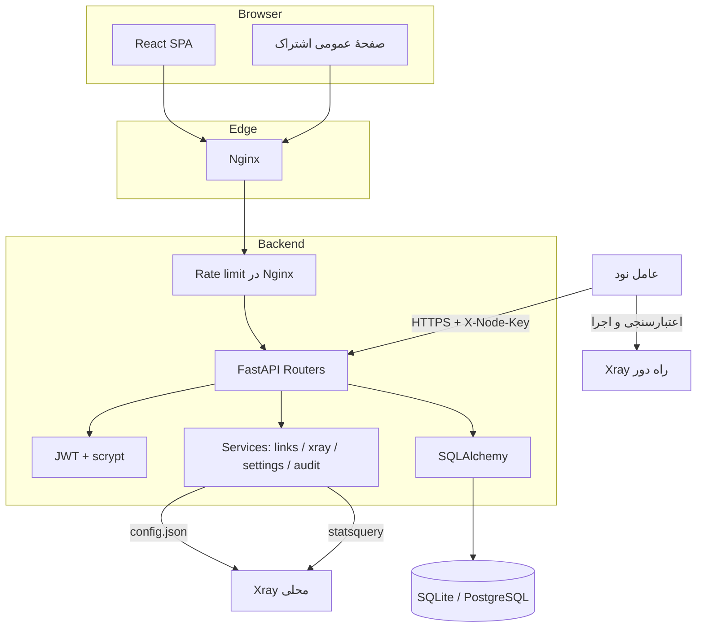
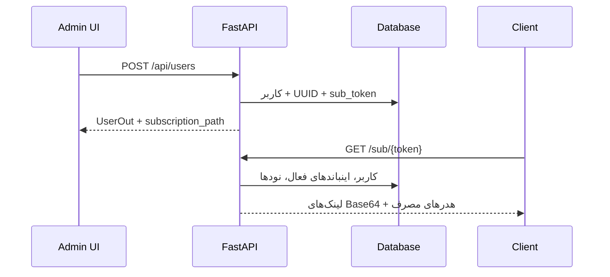
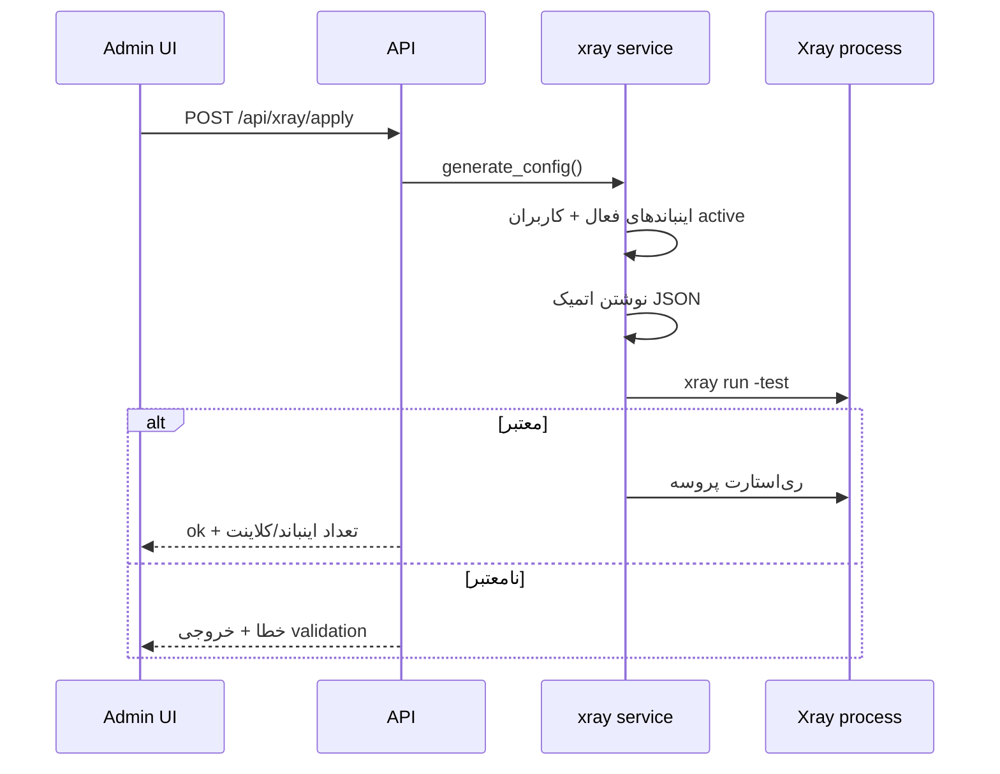
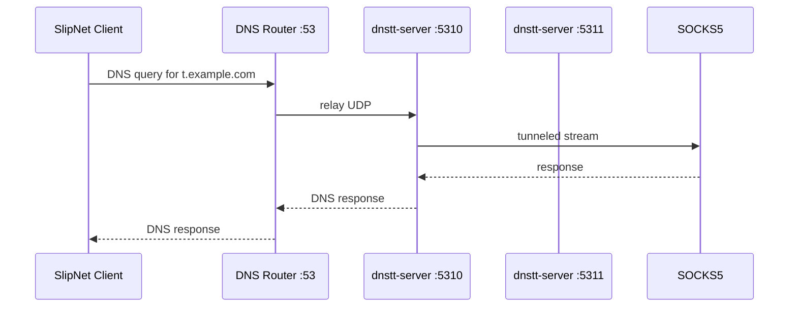
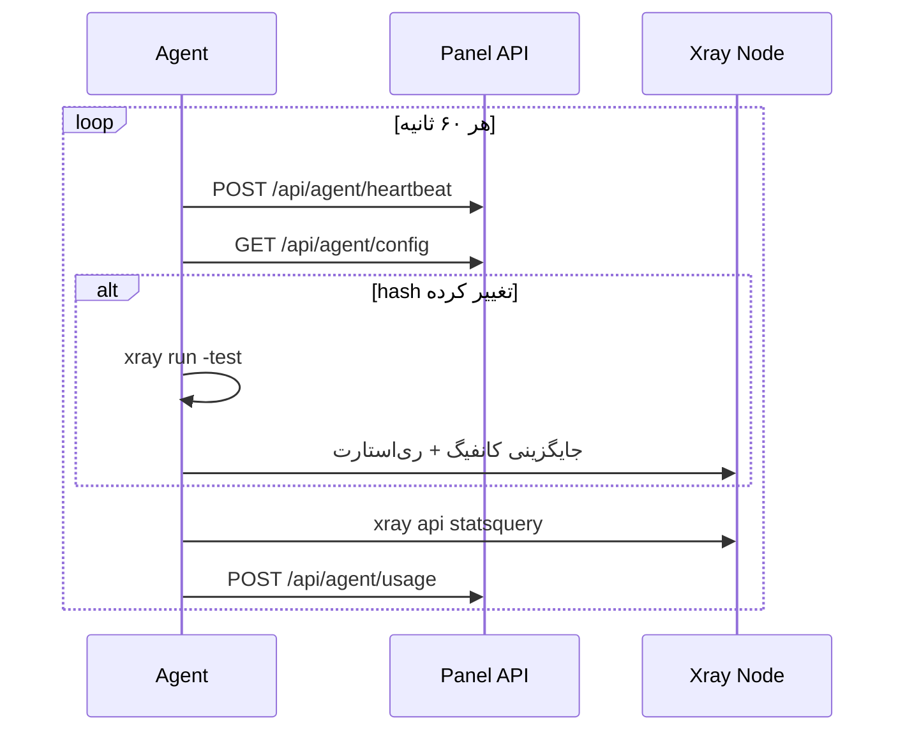

# معماری SpecterGate

این سند تصمیم‌های فنی، جریان‌های اصلی و محدودیت‌های نسخهٔ ۰.۱ را توضیح می‌دهد.

## اهداف طراحی

1. **مالکیت کامل:** هیچ وابستگی به پنل یا سرویس خارجی برای مدیریت کاربر و اینباند وجود ندارد.
2. **قابل اجرا از روز اول:** SQLite و یک نود محلی برای شروع کافی است.
3. **مسیر رشد:** همان مدل دامنه روی PostgreSQL و چند نود راه دور کار می‌کند.
4. **شفافیت:** تولید کانفیگ Xray قابل پیش‌نمایش و اعتبارسنجی است؛ عملیات مدیریتی در audit log ثبت می‌شود.
5. **رابط فارسی و RTL** با طراحی واکنش‌گرا، بدون وابستگی به CDN خارجی.

## نمای اجزا

## جریان‌های اصلی

### ۱. ورود مدیر

1. `POST /api/auth/login` نام کاربری و رمز را می‌گیرد.
2. رمز با scrypt و salt تصادفی بررسی می‌شود.
3. نشست مرورگر از `/api/auth/session` با کوکی HttpOnly و SameSite=Strict ایجاد می‌شود. در تولید، کوکی Secure و HTTPS لازم است. توکن در localStorage ذخیره نمی‌شود.
4. کلاینت‌های API می‌توانند از `/api/auth/login` توکن Bearer بگیرند. اثر انگشت هش رمز در توکن بررسی می‌شود؛ تغییر رمز، توکن‌های قبلی را باطل می‌کند. نقش و مجوز جاری از پایگاه‌داده خوانده می‌شود. نوشتن با کوکی، کنترل Origin دارد و ورود ناموفق محدود می‌شود.

### ۲. ساخت کاربر و لینک اشتراک

- `used_traffic_bytes` از جمع `upload_bytes` و `download_bytes` محاسبه می‌شود.
- وضعیت مؤثر کاربر به‌صورت پویا محاسبه می‌شود:
  - `disabled` اگر `is_active=false`؛
  - `expired` اگر `expire_at <= now`؛
  - `limited` اگر سقف حجم پر شده باشد؛
  - در غیر این صورت `active`.
- اشتراک فقط برای کاربر `active` لینک برمی‌گرداند. خروجی Clash با تشخیص User-Agent یا `?format=clash` تولید می‌شود.
- هدر `subscription-userinfo` برای کلاینت‌های سازگار، مصرف و انقضا را منتقل می‌کند.

### ۳. تولید و اعمال کانفیگ Xray

- فقط اینباندهای **نود محلی** (یا بدون نود) در کانفیگ محلی قرار می‌گیرند.
- هر اینباند `clients` مخصوص خود را از کاربران فعال می‌سازد؛ `email` کلاینت برابر UUID کاربر است تا آمار Xray قابل نگاشت باشد.
- پورت API آمار به‌صورت پیش‌فرض `10085` است و روی `127.0.0.1` شنود می‌کند.
- فایل کانفیگ ابتدا در فایل موقت نوشته و سپس `os.replace` می‌شود.

### ۴. همگام‌سازی آمار

1. `xray api statsquery` با الگوی خالی اجرا و خروجی JSON خوانده می‌شود.
2. نام‌های `user>>>UUID>>>traffic>>>uplink/downlink` تجمیع می‌شوند.
3. شمارنده‌های کاربر و اینباند به‌روزرسانی و یک `TrafficSample` ثبت می‌شود.
4. نمودار داشبورد از نمونه‌های ۷ روز اخیر ساخته می‌شود؛ جمع کل از شمارنده‌های تجمعی کاربران می‌آید.

### ۵. تونل DNS و Multiplexing

DNS Tunnels یک ماژول جدا از Xray است:

1. پنل جفت‌کلید Curve25519 (X25519) می‌سازد و پروفایل `DnsTunnel` را ذخیره می‌کند.
2. سرور DNSTT خارج از پنل با `dnstt-server` اجرا می‌شود و به یک SOCKS5 محلی وصل می‌شود.
3. برای هر کاربر، URI از نوع `slipnet://` با قالب ۶۰ فیلدی SlipGate/SlipNet v22 ساخته می‌شود. NoizDNS با نوع `sayedns` و stealth تولید می‌شود؛ سرور همان DNSTT است.
4. در حالت چندتونلی، `dns_router.py` روی UDP/53 به QNAME گوش می‌دهد و با طولانی‌ترین تطابق دامنه، کوئری را به پورت محلی `5310+` تونل مربوطه می‌فرستد.

پنل فقط کانفیگ و لینک تولید می‌کند. اجرای `dnstt-server` و شمارش per-user ترافیک DNS در نسخهٔ فعلی خارج از محدوده است.

### ۶. نود راه دور

عامل نود یک حلقهٔ Pull است:

- احراز هویت با هدر `X-Node-Key` و مقایسهٔ `Node.api_key` انجام می‌شود.
- کانفیگ نود فقط اینباندهای تخصیص‌یافته به همان نود را شامل می‌شود.
- عامل شمارنده‌های تجمعی Xray را نگه می‌دارد و فقط دلتا را گزارش می‌کند تا از دوباره‌شماری جلوگیری شود.
- پورت API هر نود از فیلد `api_port` همان نود در کانفیگ قرار می‌گیرد.

## مدل داده

| جدول | نقش | فیلدهای کلیدی |
| --- | --- | --- |
| `admins` | حساب‌های مدیریتی | `username`, `password_hash`, `role`, `is_active` |
| `vpn_users` | کاربران پروکسی | `uuid`, `password`, `sub_token`, `data_limit_bytes`, `expire_at`, `upload_bytes`, `download_bytes` |
| `nodes` | سرورهای محلی/راه دور | `address`, `api_port`, `api_key`, `is_local`, `traffic_coefficient`, `last_seen_at` |
| `inbounds` | مسیرهای اتصال | `protocol`, `port`, `network`, `security`, کلیدهای Reality، مسیر TLS |
| `dns_tunnels` | پروفایل DNSTT/NoizDNS | `domain`, `upstream_port`, `public_key`, `private_key`, `target_host`, `mtu` |
| `traffic_samples` | تاریخ مصرف | `user_id`, `node_id`, `upload_bytes`, `download_bytes`, `recorded_at` |
| `settings` | تنظیمات پویا | `key`, `value` (JSON) |
| `audit_logs` | ردپای عملیات | `admin_username`, `action`, `target_*`, `ip_address` |

روابط:

- هر `Node` چند `Inbound` دارد (حذف نود، اینباندها را حذف می‌کند).
- هر `VPNUser` چند `TrafficSample` دارد.
- `Inbound.node_id` می‌تواند خالی باشد؛ در این حالت اینباند به نود محلی تعلق دارد.

## تصمیم‌های فنی

### SQLAlchemy همگام

بار اصلی پنل I/O سبک و تعداد درخواست محدود است. Session همگام، سادگی و سازگاری SQLite/Postgres را حفظ می‌کند. برای بار سنگین می‌توان لایهٔ async را جداگانه اضافه کرد.

### هش رمز با scrypt

به‌جای وابستگی به passlib (که نگهداری فعال ندارد)، از `hashlib.scrypt` استاندارد با پارامترهای ذخیره‌شده در خروجی استفاده می‌شود. رمزها هرگز برگشت‌پذیر نیستند.

### JWT بدون refresh token

برای MVP، توکن دسترسی ۱۲ ساعته کافی است. خروج با حذف توکن سمت کلاینت انجام می‌شود؛ برای ابطال سمت سرور باید جدول session/denylist اضافه شود.

### تولید کانفیگ به‌جای ویرایش دستی

همهٔ تنظیمات اینباند در پایگاه‌داده است و کانفیگ خروجی از آن ساخته می‌شود. این کار پیش‌نمایش، اعتبارسنجی و بازتولید را ساده می‌کند. تنظیمات پیشرفته‌ای که در فرم نیستند از طریق `extra_json` قابل توسعه‌اند.

### Nginx به‌عنوان لبه

Nginx فایل‌های ساخته‌شدهٔ React را سرو می‌کند، API و اشتراک را پروکسی می‌کند و TLS و rate limit را انجام می‌دهد. پنل و API روی پورت عمومی شنود نمی‌کنند.

## امنیت

- **احراز هویت:** JWT HS256؛ کلید از محیط.
- **مجوز:** نقش‌های `superadmin`، `admin` و `viewer` در وابستگی‌های API اعمال می‌شوند. عملیات نوشتن برای viewer مسدود است.
- **کلید نود:** توکن تصادفی ۳۲ بایتی؛ فقط هش نمی‌شود چون باید به عامل داده شود، بنابراین دسترسی به جدول/DB حساس است.
- **کلید خصوصی Reality:** در دیتابیس و کانفیگ Xray ذخیره می‌شود؛ فایل کانفیگ با دسترسی محدود و volume محافظت‌شده نگه داشته شود.
- **ورودی‌ها:** Pydantic طول، الگو و بازه‌ها را اعتبارسنجی می‌کند؛ تگ اینباند الگوی محدود دارد.
- **امنیت انتقال:** TLS در Nginx؛ پروکسی هدرهای `X-Forwarded-*` را تنظیم می‌کند.
- **محدودیت نرخ:** endpoint ورود در Nginx rate limit دارد؛ برای محیط چندنمونه‌ای بهتر است در لایهٔ Redis هم اضافه شود.

## مقیاس‌پذیری

| مرحله | پیشنهاد |
| --- | --- |
| شروع | SQLite + یک نود محلی + Docker |
| چند صد کاربر | PostgreSQL، بکاپ دوره‌ای، Nginx روی میزبان |
| چند نود | عامل Pull روی هر نود، پورت‌های مستقل، مانیتورینگ سیستم |
| چند هزار کاربر | ایندکس‌های بیشتر روی نمونه‌های ترافیک، جداسازی گزارش‌گیری، صف/Worker برای اعمال کانفیگ |
| چند نمونهٔ API | PostgreSQL مشترک + leader election برای مدیریت پروسهٔ Xray + rate limit مشترک |

## محدودیت‌های شناخته‌شده

1. اعمال خودکار محدودیت روی Xray محلی هنگام رسیدن به سقف انجام نمی‌شود؛ نیاز به یک scheduler دارد. عامل نود راه دور این کار را با Pull انجام می‌دهد.
2. `last_online_at` کاربر از HandlerService پر نمی‌شود.
3. Migration خودکار (Alembic) وجود ندارد.
4. آمار per-inbound برای هر کاربر ثبت نمی‌شود؛ نمونه‌ها در سطح کاربر و نود هستند.
5. امکان مدیریت ادمین از UI و ابطال فوری JWT نیست.
6. فایل کانفیگ محلی در مسیر پیش‌فرض `backend/data/xray/config.json` قرار می‌گیرد؛ در استقرار واقعی مسیر پایدار و بکاپ‌شده انتخاب کنید.
7. تونل‌های DNS توسط پنل اجرا/مانیتور نمی‌شوند و ترافیکشان در سقف حجم کاربر شمرده نمی‌شود.
8. قالب `slipnet://` بر پایهٔ نسخهٔ v22 SlipGate است و ممکن است با تغییر کلاینت SlipNet نیاز به به‌روزرسانی داشته باشد.

## مسیر توسعه

- اجرا و مانیتور خودکار `dnstt-server` و DNS router از داخل پنل؛
- accounting ترافیک DNS و اتصال آن به سقف کاربر؛
- schedulers برای sync و enforcement؛
- Alembic و بکاپ؛
- XHTTP/Hysteria2؛
- مدیریت ادمین و مجوزهای ریزدانه؛
- مانیتورینگ Prometheus و هشدار؛
- ابزار مهاجرت از Hiddify/PasarGuard.
